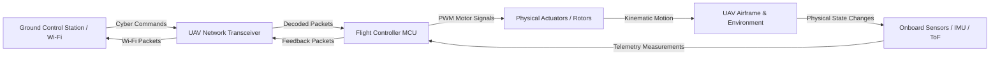

# 01. Project Overview & Problem Statement

## 1. What is an Unmanned Aerial Vehicle (UAV)?
An **Unmanned Aerial Vehicle (UAV)**, commonly referred to as a drone, is an aircraft operated without an onboard human pilot. Flight is governed either autonomously via onboard computers (flight controller firmware such as PX4, ArduPilot) utilizing inertial guidance and GPS, or remotely by a human pilot via a Command-and-Control (C2) datalink over wireless protocols (e.g., 802.11 Wi-Fi, radio frequency links).

## 2. What is a Cyber-Physical System (CPS)?
A **Cyber-Physical System (CPS)** is an engineered system that integrates computational algorithms, networking capabilities, and physical processes. In a UAV:
- The **Cyber Domain** encompasses computer networking, software processes, packet exchanges, wireless transceivers (Wi-Fi, telemetry), and encryption.
- The **Physical Domain** encompasses hardware dynamics, aerodynamics, kinematics, sensor measurements (accelerometers, gyroscopes, barometers, Time-of-Flight sensors), and motor actuators (Electronic Speed Controllers, propellers).

Feedback loops couple both domains: physical sensors inform cyber control algorithms, which compute setpoints sent across cyber communication buses to drive physical motors.

## 3. What is UAV Cybersecurity?
UAV cybersecurity is the discipline of protecting an unmanned aircraft's computation, communication links, sensor suites, and physical actuation from unauthorized exploitation, disruption, manipulation, or seizure. Unlike conventional IT systems where a breach typically results in data exfiltration or downtime, cyberattacks against UAVs cause kinetic failure: sudden loss of attitude control, crashes into civilians or infrastructure, physical asset hijacking, or airborne collisions.

## 4. Why are UAVs Vulnerable to Cyberattacks?
1. **Unencrypted / Weak Wireless Protocols**: Many commercial and tactical UAVs utilize 802.11 Wi-Fi or unauthenticated radio links for control and video streaming to minimize communication latency and hardware weight.
2. **Resource Constraints**: Flight microcontrollers (STM32, Cortex-M4/M7) have tight CPU, memory, and battery budgets, preventing the deployment of heavy cryptographic suites or deep packet inspection firewalls.
3. **Open RF Spectrum**: Wi-Fi management frames (such as IEEE 802.11 deauthentication frames) are transmitted over the air in the clear in systems lacking 802.11w Protected Management Frames (PMF).
4. **Sensor Vulnerabilities**: Physical sensors (accelerometers, gyroscopes, magnetometers) are susceptible to intentional electromagnetic, acoustic, or false data injection interference.

## 5. What is an Intrusion Detection System (IDS)?
An **Intrusion Detection System (IDS)** is a software mechanism that monitors system activity, audits logs and telemetry, detects policy violations or malicious anomalies, and raises alerts to operators or automated countermeasures.

## 6. Why is Ordinary Network IDS Insufficient for UAVs?
Traditional Network Intrusion Detection Systems (NIDS) inspect only network headers (IP, TCP, UDP, MAC). This creates blind spots:
- **Blind to Sensor Spoofing & FDI**: False Data Injection (FDI) attacks can be crafted using perfectly valid network packet structures that pass all CRC checks, sequence numbers, and packet lengths while carrying corrupted velocity or attitude targets.
- **Blind to Physical Consequences**: An attacker may flood the network, but a network IDS cannot determine whether the aircraft is hovering safely on an autonomous failsafe or tumbling out of control.
- **High False Positive Rates**: Network congestion or RF attenuation can mimic Denial-of-Service attacks without posing a flight hazard.

## 7. Why Must Cyber and Physical Features Be Analyzed Together?
By fusing **21 Cyber features** (MAC headers, sequence counts, frame length, SNR, data rate) with **11 Physical features** (pitch, roll, yaw, 3-axis velocities, 3-axis accelerations, flight time, ToF distance), the IDS correlates protocol anomalies with airframe kinematics:
- **De-authentication DoS**: Sudden frame duration and sequence anomalies in the cyber domain coupled with a plateau or drift in physical velocity.
- **Replay Attacks**: Duplicate sequence numbers and static MAC timestamps in the cyber domain while the physical drone drifts because control setpoints are stale.
- **Evil Twin**: Signal quality and BSSID discrepancies in the cyber domain with delayed physical response.
- **False Data Injection (FDI)**: Normal cyber packet headers with abrupt, non-aerodynamic step jumps in physical Euler angles or acceleration vectors.

## 8. What Problem Does This Project Solve?
The baseline literature (IEEE T-ITS 2023 benchmark) established that combining cyber and physical features improves binary attack detection over either domain alone. However, prior systems had critical limitations:
1. **Binary Only**: They classified samples as "attack" vs "normal" without identifying *which* specific attack occurred.
2. **Passive Attention**: CP-Attn-Lite uses an attention gate, but attention weights are computed purely from latent feature encodings without any empirical measurement of whether the incoming data stream is degraded or spoofed.
3. **Forced Predictions**: Softmax classifiers output a prediction for every input even when inputs are completely corrupt, leading to overconfident false classifications.

**Our Proposed Solution: RA-SAFE (Reliability-Aware Selective Fusion)**:
- Separates cyber (21) and physical (11) modalities into independent convolutional encoders.
- Evaluates explicit empirical data quality ($Q_c, Q_p \in [0, 1]$) from inference-time observables.
- Estimates branch predictive uncertainty ($U_c, U_p \in [0, 1]$) using auxiliary classification heads and Shannon entropy.
- Computes integrated branch reliability ($R_c = Q_c(1 - U_c), R_p = Q_p(1 - U_p)$).
- Drives a learnable adaptive fusion gate ($[w_c, w_p] = \text{Softmax}(g(\dots))$).
- Applies post-hoc temperature scaling ($T=0.8553$) to calibrate probabilities.
- Implements a selective prediction engine: accepts confident, reliable predictions and **abstains** ("Uncertain — Human Review Required") when inputs are untrustworthy.

## 9. Who Would Use This System?
- **UAV Fleet Operators & Ground Control Stations (GCS)**: For real-time flight integrity monitoring and situational awareness.
- **Autonomous Drone Delivery Systems**: To safeguard BVLOS (Beyond Visual Line of Sight) cargo drones against hijacking.
- **Defense & Perimeter Security Drones**: To detect RF jamming, spoofing, and C2 disruption in contested environments.
- **UAV Incident Investigators**: To reconstruct telemetry during post-flight forensic audits.

## 10. What Happens if the System Fails to Detect an Attack?
- **De-auth DoS Missed**: The UAV loses connection to the pilot, potentially triggering unmonitored fly-away or uncontrolled landing.
- **Replay Attack Missed**: The drone executes obsolete commands, colliding with obstacles.
- **Evil Twin Missed**: The drone connects to a malicious access point, allowing full unauthorized telemetry extraction or route override.
- **FDI Missed**: Manipulated attitude setpoints cause flight instability, structural overstress, or inverted crashes.

## 11. Practical Applications
- Real-time onboard embedded coprocessor (e.g., Raspberry Pi 4, Nvidia Jetson Orin Nano running next to a Pixhawk flight controller).
- GCS telemetry plugin analyzing MAVLink telemetry packets in real time.
- Forensic intrusion analysis engine.

## 12. Key Limitations of the Current Implementation
1. **Synthetic Physical Features in the T-ITS Benchmark**: The 11 physical telemetry features in `Dataset_T-ITS.csv` were constructed in `scripts/prepare_dataset.py` using attack-conditioned Gaussian distributions. While structurally and mathematically sound for demonstrating multi-modal fusion algorithms, they do not represent real hardware sensor recordings.
2. **Offline Log Replay vs. Live Radio**: The streaming demo replays pre-recorded CSV rows rather than ingesting live 802.11 monitor-mode packet captures (`pcap`) or MAVLink radio streams.
3. **Static Window Processing**: Conv1D feature extractors operate on instantaneous row vectors rather than deep recurrent state histories across extended flight trajectories.

---

## Elevator Pitches & Presentation Summaries

### 30-Second Project Introduction
> "Wi-Fi controlled UAVs are vulnerable to cyberattacks like de-authentication DoS and physical attacks like false data injection. Traditional network firewalls miss sensor spoofing, while sensor monitors miss network attacks. Our project develops RA-SAFE, an intrusion detection system that simultaneously analyzes 21 cyber features and 11 physical telemetry features. RA-SAFE calculates real-time data reliability, dynamically shifts attention to the trustworthy modality, and abstains from making dangerous guesses when sensors or networks are compromised, achieving over 94% accuracy on accepted predictions."

### 1-Minute Project Explanation
> "Commercial drones operate as cyber-physical systems where wireless commands directly control physical airframes. If an adversary attacks the Wi-Fi link with de-authentication floods or injects false telemetry, the drone risks crashing or being hijacked. Existing intrusion detection architectures like CP-Attn-Lite use attention gates, but standard attention cannot tell whether an incoming sensor or network channel has been corrupted. 
> To solve this, we designed RA-SAFE: Reliability-Aware Selective Fusion. RA-SAFE processes 21 cyber features and 11 physical features through independent neural encoders. It introduces an empirical modality reliability estimator and predictive uncertainty heads. A learnable gating network dynamically balances cyber and physical weights based on data quality. Furthermore, calibrated selective prediction allows the system to abstain when evidence is ambiguous, triggering an operator action playbook instead of committing to catastrophic false alarms. On the T-ITS benchmark, RA-SAFE reduces selective classification risk to just 5.71%."

### 3-Minute Detailed Project Walkthrough
> "Good morning/afternoon. Today I present our work on RA-SAFE: A Reliability-Aware Selective Fusion Architecture for UAV Cyber-Physical Intrusion Detection.
> 
> Unmanned Aerial Vehicles operate under tightly coupled cyber-physical feedback loops. A pilot sends Wi-Fi commands, while onboard gyroscopes and accelerometers maintain level flight. An attacker can strike either side: executing de-authentication DoS or Evil Twin attacks over the air, or injecting false sensor readings into the telemetry bus.
> 
> Prior literature demonstrated that fusing network features with flight telemetry detects intrusions better than inspecting either domain alone. However, state-of-the-art dual-branch models like CP-Attn-Lite have a fatal flaw: their attention mechanisms only evaluate latent representations. If RF jamming destroys the Wi-Fi signal or an accelerometer freezes, CP-Attn-Lite cannot assess data validity and may assign high attention to corrupted inputs. Furthermore, standard softmax outputs are overconfident and forced to guess on every sample.
> 
> In this project, we designed and implemented RA-SAFE. RA-SAFE features two separate convolutional branches: a 21-feature cyber branch and an 11-feature physical branch. On top of these encoders, we built three novel modules:
> First, a Modality Reliability Estimator that computes empirical quality scores $Q_c$ and $Q_p$ between 0 and 1 using strictly inference-time observables such as SNR, sequence continuity, and kinematic acceleration bounds, without using any ground-truth attack labels.
> Second, an Uncertainty-Aware Adaptive Gate that derives predictive entropy $U_c$ and $U_p$ from auxiliary classification heads, computes unified branch reliability scores $R_c$ and $R_p$, and feeds a 70-dimensional multimodal vector into a learnable softmax gate. Under RF jamming, the gate automatically suppresses the cyber weight and transfers attention to physical telemetry.
> Third, a Calibrated Selective Prediction Engine. We apply temperature scaling on validation data, optimizing the temperature parameter to 0.8553 and cutting Expected Calibration Error from 0.048 down to 0.020. The system accepts predictions when confidence and reliability exceed calibrated safety thresholds, and abstains with an explicit operator recommendation when inputs are compromised.
> 
> In our empirical benchmarks across 8 degradation scenarios, RA-SAFE maintains 94.3% accuracy on accepted samples under clean conditions, 94.2% under 20% packet loss, and 89.6% under hostile RF jamming. When dual-domain failure occurs, where baseline CP-Attn-Lite collapses to 38.3% accuracy, RA-SAFE achieves 66.6% on accepted samples and flags the remaining ambiguous cases for human intervention. The entire neural model comprises only 4,465 parameters with an inference latency of just 0.063 milliseconds per sample, making it fully viable for real-time onboard flight deployment. Thank you."

---

## Formal Research Paper Abstract
> **Abstract**—Unmanned Aerial Vehicles (UAVs) increasingly operate as safety-critical Cyber-Physical Systems (CPS) whose autonomous flight depends upon wireless Command and Control (C2) communications and onboard sensor telemetry. While multi-modal intrusion detection systems combining network and kinematic observations have demonstrated superior detection capabilities over single-domain approaches, existing architectures rely on passive attention mechanisms that fail to verify data trustworthiness. Under severe communication degradation, radio frequency jamming, or sensor faults, conventional models generate overconfident, erroneous classifications. In this work, we propose **RA-SAFE** (*Reliability-Aware Selective Fusion for UAV Cyber-Physical Intrusion Detection*), a lightweight multi-branch deep learning architecture designed for robust 5-class attack identification (Benign, DoS, Replay, Evil Twin, and False Data Injection). RA-SAFE introduces: (i) an unsupervised Modality Reliability Estimator that quantifies cyber and physical data quality ($Q_c, Q_p \in [0, 1]$) from inference-time observables; (ii) branch-level predictive uncertainty quantification ($U_c, U_p \in [0, 1]$) derived from auxiliary classification heads; (iii) a learnable reliability-aware adaptive fusion gate that dynamically balances modality weights ($w_c, w_p$); and (iv) a calibrated selective prediction mechanism utilizing post-hoc temperature scaling ($T=0.8553$) to enable prudent abstention under unresolvable ambiguity. Evaluated on the standardized IEEE T-ITS UAV benchmark, RA-SAFE contains only 4,465 parameters with an inference latency of 0.063 ms/sample. Under nominal conditions, RA-SAFE achieves 94.29% accuracy on the accepted prediction set with a selective risk of 5.71%, reducing Expected Calibration Error (ECE) to 0.0202. Stress testing under simulated packet loss, RF jamming, and sensor bias demonstrates that RA-SAFE dynamically reallocates attention to unaffected channels and abstains under dual-domain degradation, preventing catastrophic false alarms.
