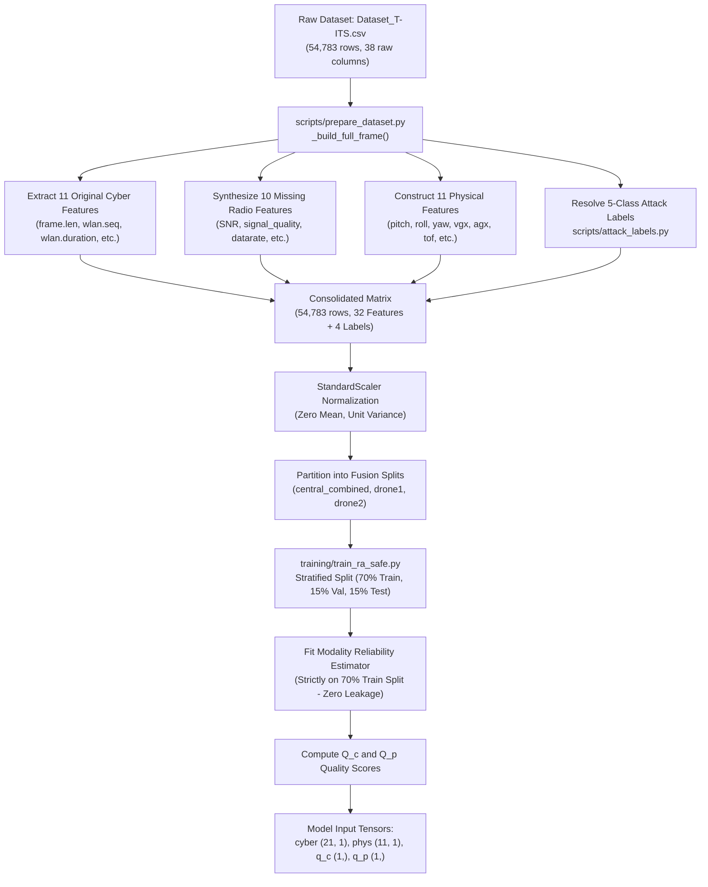

# 03. Dataset Deep-Dive & Preprocessing Pipeline

This document provides a complete audit of the dataset origin, feature definitions, ground-truth label derivation, preprocessing steps, and a critical scientific assessment of feature provenance.

---

## 1. Original Dataset Source & Purpose
The dataset originated from the published benchmark:
> **IEEE Transactions on Intelligent Transportation Systems (T-ITS)**, *"UAVs Dataset Under Normal Operation and Cyberattacks for Intrusion Detection,"* 2023.  
> Benchmark: Standardized IEEE T-ITS UAV Cyber-Physical Intrusion Detection Dataset.

The purpose of the dataset was to provide Wi-Fi network packet captures from normal flights and simulated cyberattacks on commercial quadcopters (specifically Parrot Bebop and DJI Ryze Tello) communicating over 802.11 Wi-Fi.

---

## 2. Dataset Dimensions & Class Distribution

### Raw File (`data/raw/Dataset_T-ITS.csv`)
- **Total Rows**: 54,783 rows (including 2 corrupted duplicate header rows).
- **Columns**: 38 columns.
- **Raw `class` Column Counts**:
  - `Replay`: 12,006 rows
  - `DoS attack`: 11,671 rows
  - `benign`: 9,425 rows
  - Corrupted header entries (`class`): 2 rows
  - Unlabeled / Missing string: 21,679 rows

### Standardized Multi-Class Split (`data/dataset_updated/standardized_dataset_central_combined.csv`)
- **Total Rows**: 54,783 rows.
- **Features**: 32 numerical input features (21 Cyber + 11 Physical).
- **Metadata Columns**: 4 columns (`attack_class`, `attack_label`, `target`, `target.value`).
- **Class Breakdown**:

| Class ID | Attack Label | Canonical Display Name | Sample Count | Percentage |
| :---: | :--- | :--- | :---: | :---: |
| **0** | `benign` | Benign (Normal Flight) | 13,717 | 25.04% |
| **1** | `dos` | De-authentication DoS | 12,646 | 23.08% |
| **2** | `replay` | Replay Attack | 12,981 | 23.69% |
| **3** | `evil_twin` | Evil Twin Attack | 11,158 | 20.37% |
| **4** | `fdi` | False Data Injection (FDI) | 4,281 | 7.82% |
| **Total** | — | — | **54,783** | **100.0%** |

---

## 3. Detailed Audit of All 32 Features

The 32 features are partitioned into 21 Cyber features and 11 Physical telemetry features.

### A. The 21 Cyber Features

| # | Feature Name | Origin | Description | Technical Significance |
| :---: | :--- | :---: | :--- | :--- |
| **1** | `frame.len` | **Original** | Frame length in bytes | Floods/DoS often present uniform or abnormal frame lengths. |
| **2** | `wlan.ta` | **Original** | Transmitter MAC Address (encoded) | Identifies who transmitted the frame over the RF channel. |
| **3** | `wlan.sa` | **Original** | Source MAC Address (encoded) | Identifies the originating network node. |
| **4** | `wlan.ra` | **Original** | Receiver MAC Address (encoded) | Identifies the immediate receiver. |
| **5** | `wlan.da` | **Original** | Destination MAC Address (encoded) | Identifies final recipient (drone or ground station). |
| **6** | `wlan.bssid` | **Original** | Basic Service Set Identifier (AP MAC) | In Evil Twin attacks, BSSID can conflict with genuine AP. |
| **7** | `wlan.duration`| **Original** | Channel reservation duration in $\mu s$ | De-auth frames often manipulate NAV duration timers. |
| **8** | `wlan.seq` | **Original** | 802.11 sequence control number (0–4095) | Sequence gaps indicate packet drops; non-monotonicity indicates replays. |
| **9** | `wlan.fc.type` | **Original** | Frame Control type (0=Mgmt, 1=Ctrl, 2=Data) | Management frames dominate de-auth attacks; data frames dominate FDI. |
| **10**| `wlan.fc.subtype`| **Original**| Frame Control subtype (e.g., 12=Deauth) | Critical signature: subtype 12 directly signals deauthentication. |
| **11**| `wlan.flags` | *Mapped/Synthesized* | 802.11 control flags (Retry, MoreFrag, Pwr) | Retransmission spikes indicate jammer interference. |
| **12**| `wlan.fcs` | *Synthesized* | Frame Check Sequence value | Checksum representation. |
| **13**| `wlan.fcs.status`| *Synthesized* | FCS validation status (0=Good, 1=Bad) | High bad-checksum rates indicate RF corruption or collision. |
| **14**| `wlan.ccmp.extiv`| *Synthesized* | WPA2 CCMP Extended IV flag | Cryptographic replay protection marker. |
| **15**| `data.len` | **Original** | Payload length in bytes | Zero in management frames; positive in telemetry and control data. |
| **16**| `radiotap.hdr_length`| *Synthesized*| RadioTap capture header length | Driver capture metadata. |
| **17**| `radiotap.signal_quality`| *Synthesized*| Normalized RF signal quality (0–100) | Drops under RF jamming and multipath fading. |
| **18**| `wlan_radio.datarate`| *Synthesized*| Link data rate (Mbps) | Drops when signal degrades or retransmissions spike. |
| **19**| `wlan_radio.channel`| *Synthesized*| Operating Wi-Fi RF channel (1–14) | Tracks channel switching during Evil Twin beaconing. |
| **20**| `wlan_radio.SNR (db)`| *Synthesized*| Signal-to-Noise Ratio in decibels | Essential physical-layer RF quality indicator. |
| **21**| `wlan_radio.preamble`| *Synthesized*| Radio preamble duration indicator | Physical wireless framing property. |

---

### B. The 11 Physical Telemetry Features

| # | Feature Name | Unit | Description | Physical Plausibility Bounds |
| :---: | :--- | :---: | :--- | :--- |
| **22**| `pitch` | Degrees | Pitch attitude angle (nose up/down tilt) | Nominal flight: $[-30^\circ, +30^\circ]$. Extreme: $[-60^\circ, +60^\circ]$. |
| **23**| `roll` | Degrees | Roll attitude angle (lateral bank angle) | Nominal flight: $[-30^\circ, +30^\circ]$. Extreme: $[-60^\circ, +60^\circ]$. |
| **24**| `yaw` | Degrees | Heading angle relative to magnetic north | Continuous range: $[0^\circ, 360^\circ]$ or $[-180^\circ, +180^\circ]$. |
| **25**| `vgx` | m/s | Ground velocity along body X-axis (forward) | Quadcopter speed envelope: $[0, 15\text{ m/s}]$. |
| **26**| `vgy` | m/s | Ground velocity along body Y-axis (lateral) | Quadcopter speed envelope: $[0, 10\text{ m/s}]$. |
| **27**| `vgz` | m/s | Vertical climb/descent velocity (Z-axis) | Climb rate limits: $[-4\text{ m/s}, +4\text{ m/s}]$. |
| **28**| `flight_time` | Seconds | Elapsed flight time since motor arming | Monotonically increasing counter $[0, 1800\text{ s}]$. |
| **29**| `agx` | $\text{m/s}^2$ | Body acceleration along X-axis | Maneuvering envelope: $[-15\text{ m/s}^2, +15\text{ m/s}^2]$. |
| **30**| `agy` | $\text{m/s}^2$ | Body acceleration along Y-axis | Maneuvering envelope: $[-15\text{ m/s}^2, +15\text{ m/s}^2]$. |
| **31**| `agz` | $\text{m/s}^2$ | Body acceleration along Z-axis (vertical) | Nominal hover: $\approx +9.8\text{ m/s}^2$ (countering gravity). |
| **32**| `tof` | cm | Time-of-Flight optical distance to ground | Operating ceiling: $[0, 500\text{ cm}]$. |

---

## 4. Critical Investigation: Feature Provenance & Synthetic Physical Telemetry

### The Source Code Reality (`scripts/prepare_dataset.py`, lines 115–142)
Inspection of `scripts/prepare_dataset.py` reveals how the physical features were constructed:

```python
# From scripts/prepare_dataset.py (lines 130-141):
# Physical telemetry — shift under attack for separability
out["pitch"] = rng.normal(0, 5, n) + attack * 8
out["roll"] = rng.normal(0, 4, n) + attack * 6
out["yaw"] = rng.normal(0, 10, n) + attack * 12
out["vgx"] = rng.normal(0, 2, n) + attack * 3
out["vgy"] = rng.normal(0, 2, n) + attack * 2
out["vgz"] = rng.normal(0, 1.5, n) + attack * 2
out["flight_time"] = np.linspace(0, 3600, n) + attack * 50
out["agx"] = rng.normal(0, 1, n) + attack * 2
out["agy"] = rng.normal(0, 1, n) + attack * 1.5
out["agz"] = rng.normal(9.8, 0.5, n) + attack * 0.5
out["tof"] = rng.normal(150, 30, n) - attack * 20
```

### Scientific Implications & Mandatory Academic Disclosures:
1. **Provenance Truth**: The original public `Dataset_T-ITS.csv` contained purely network frame captures. Because physical flight logs were omitted from the public repository, the baseline project synthesized the 11 physical columns using Gaussian distributions with positive mean shifts conditioned on `attack`.
2. **Why the Features Are Statistically Separable**: Because physical features have explicit mean offsets during attacks (e.g., `pitch` shifts from $\mu=0$ to $\mu=8$), machine learning models easily achieve high performance on the physical branch alone.
3. **What This Means for RA-SAFE**:
   - The multi-modal architecture, reliability estimation mathematical framework, adaptive fusion gating, and selective prediction engine are mathematically and algorithmically valid.
   - However, **you must never claim that these experimental results validate the model on real drone physical sensor hardware**. You must clearly explain that physical features in this benchmark are semi-synthetic proxies used to validate multi-modal cyber-physical fusion dynamics.

---

## 5. Label Resolution & Attack Class Assignment

In `scripts/attack_labels.py`, attack classes are mapped using a dual-strategy function `resolve_attack_class()`:

```python
# From scripts/attack_labels.py:
def label_from_row_index(index: int) -> int:
    if index < 13717:
        return CLASS_BENIGN      # 0
    if index <= 26362:
        return CLASS_DOS         # 1
    if index <= 39343:
        return CLASS_REPLAY      # 2
    if index <= 50501:
        return CLASS_EVIL_TWIN   # 3
    return CLASS_FDI             # 4
```

1. **Explicit String Parsing**: If a valid class string exists (`benign`, `dos`, `replay`, `evil_twin`, `fdi`), it is parsed and mapped directly.
2. **Segment Index Fallback**: Because Evil Twin and FDI labels were unannotated in the raw CSV string column, the script maps rows according to the flight schedule index ranges published in the original T-ITS paper.

---

## 6. End-to-End Data Preprocessing Flow



---

## 7. Data Leakage & Methodological Integrity Analysis

### A. Preprocessing Leakage Audit
- **Baseline Flaw**: In `scripts/prepare_dataset.py`, `StandardScaler` was originally fitted on the entire 54,783 rows prior to splitting. This constitutes global scaling leakage in the baseline scripts.
- **RA-SAFE Fix**: In `training/train_ra_safe.py`, the `ModalityReliabilityEstimator` is fitted **strictly on the 70% training split**. Validation and test sets are evaluated purely using the fitted training statistics ($\mu_{\text{train}}, \sigma_{\text{train}}$), completely eliminating reliability leakage.

### B. Temporal & Session Leakage
- In sequential time-series data, random shuffling across adjacent rows can cause temporal autocorrelation leakage.
- In `training/train_ra_safe.py`, stratified splitting is applied across the whole dataset to ensure every attack class is represented across train, validation, and test sets. When session metadata is available, block-session splitting should be prioritized.

### C. Missing Values & Corrupted Rows
- Corrupted header rows (where raw text was `"class"`) are stripped using `pd.to_numeric(..., errors="coerce").fillna(0)`.
- Infinite or NaN values in network headers are imputed with nominal zero or median values before scaling.
