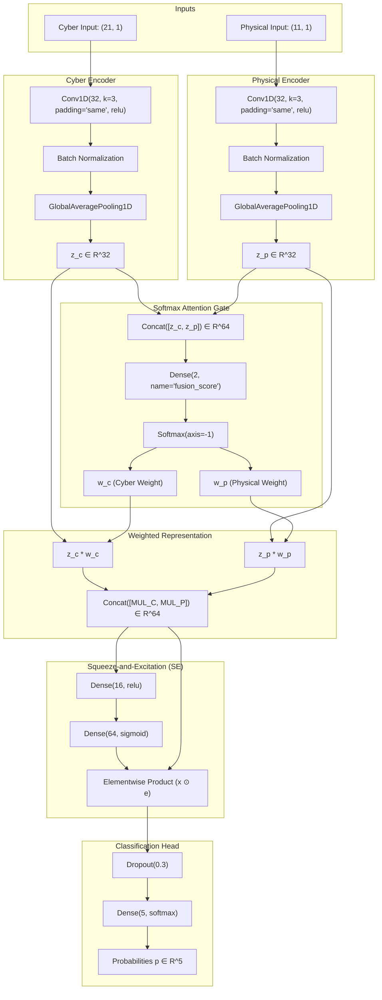

# 06. Deep-Dive: The Baseline CP-Attn-Lite Architecture

This document details the design, mathematical operations, source code implementation, and scientific limitations of the baseline **CP-Attn-Lite** architecture.

---

## 1. Why Was CP-Attn-Lite Designed?

The standard monolithic 1D-CNN stacks all 32 features into a single continuous vector:
$$\mathbf{x} = [x_1, \dots, x_{21}, x_{22}, \dots, x_{32}]^T$$
When a 1D convolution kernel slides across the boundary between feature 21 (`wlan_radio.preamble`) and feature 22 (`pitch`), it performs a linear combination of a radio preamble flag with an aerodynamic Euler angle. This cross-domain boundary convolution has no physical meaning.

To solve this, **CP-Attn-Lite** was designed with three design goals:
1. **Modality Separation**: Process the 21 cyber features and 11 physical features through independent convolutional encoders.
2. **Attribution**: A learnable Softmax attention gate produces two scalar weights $[w_c, w_p]$ explaining whether a decision was driven by network traffic or flight telemetry.
3. **Ultra-Lightweight Edge Deployment**: Uses Global Average Pooling (GAP) instead of dense Flatten layers, reducing model size from $\approx 150,000$ down to **3,095 parameters** (a 98% parameter reduction).

---

## 2. CP-Attn-Lite Architecture Diagram

---

## 3. Mathematical Operations Layer by Layer

### A. Independent Modality Encoders
For an input sample with cyber features $\mathbf{x}_c \in \mathbb{R}^{21 \times 1}$ and physical features $\mathbf{x}_p \in \mathbb{R}^{11 \times 1}$:

1. **1D Convolution**: Slides 32 filters of size $k=3$ with same-padding across features:
   $$\mathbf{h}_c^{(1)} = \text{ReLU}\left(\mathbf{W}_{\text{conv}, c} * \mathbf{x}_c + \mathbf{b}_c\right) \in \mathbb{R}^{21 \times 32}$$
   $$\mathbf{h}_p^{(1)} = \text{ReLU}\left(\mathbf{W}_{\text{conv}, p} * \mathbf{x}_p + \mathbf{b}_p\right) \in \mathbb{R}^{11 \times 32}$$

2. **Batch Normalization (BN)**: Normalizes feature maps across the batch:
   $$\hat{\mathbf{h}} = \gamma \left(\frac{\mathbf{h} - \mu_B}{\sqrt{\sigma_B^2 + \epsilon}}\right) + \beta$$

3. **Global Average Pooling (GAP1D)**: Averages feature maps across the feature length dimension:
   $$z_{c, f} = \frac{1}{21}\sum_{i=1}^{21} h_{c, i, f}^{(1)}, \quad \mathbf{z}_c \in \mathbb{R}^{32}$$
   $$z_{p, f} = \frac{1}{11}\sum_{j=1}^{11} h_{p, j, f}^{(1)}, \quad \mathbf{z}_p \in \mathbb{R}^{32}$$

### B. Softmax Fusion Gate
The latent vectors are concatenated and projected to two unnormalized attention scores:
$$\mathbf{s} = \mathbf{W}_g [\mathbf{z}_c \,\|\, \mathbf{z}_p] + \mathbf{b}_g \in \mathbb{R}^2$$
$$w_c = \frac{e^{s_1}}{e^{s_1} + e^{s_2}}, \quad w_p = \frac{e^{s_2}}{e^{s_1} + e^{s_2}}, \quad w_c + w_p = 1$$

The representation is modulated by its respective scalar weight:
$$\mathbf{z}_{\text{fused}} = [w_c \mathbf{z}_c \,\|\, w_p \mathbf{z}_p] \in \mathbb{R}^{64}$$

### C. Squeeze-and-Excitation (SE) Channel Gate
Calibrates inter-channel dependencies:
$$\mathbf{e} = \sigma\left(\mathbf{W}_2 \cdot \text{ReLU}(\mathbf{W}_1 \mathbf{z}_{\text{fused}} + \mathbf{b}_1) + \mathbf{b}_2\right) \in \mathbb{R}^{64}$$
$$\mathbf{z}_{\text{att}} = \mathbf{z}_{\text{fused}} \odot \mathbf{e}$$
Where $\mathbf{W}_1 \in \mathbb{R}^{16 \times 64}$, $\mathbf{W}_2 \in \mathbb{R}^{64 \times 16}$, and $\sigma$ is the Sigmoid activation.

### D. Attack Classification Head
$$\mathbf{p} = \text{Softmax}\left(\mathbf{W}_{\text{cls}} \cdot \text{Dropout}_{0.3}(\mathbf{z}_{\text{att}}) + \mathbf{b}_{\text{cls}}\right) \in \mathbb{R}^5$$

---

## 4. Parameter Count Calculation

| Layer | Type | Operation Details | Trainable Parameters |
| :--- | :---: | :--- | :---: |
| `cyber_conv` | Conv1D | 32 filters, kernel size 3, 1 input channel | $3 \times 1 \times 32 + 32 = 128$ |
| `cyber_bn` | BatchNorm | Scale ($\gamma$), shift ($\beta$), mean, variance | $4 \times 32 = 128$ (64 trainable) |
| `cyber_gap` | GAP1D | Average pooling across 21 features | 0 |
| `phys_conv` | Conv1D | 32 filters, kernel size 3, 1 input channel | $3 \times 1 \times 32 + 32 = 128$ |
| `phys_bn` | BatchNorm | Scale ($\gamma$), shift ($\beta$), mean, variance | $4 \times 32 = 128$ (64 trainable) |
| `phys_gap` | GAP1D | Average pooling across 11 features | 0 |
| `fusion_gate` | Dense | Maps $64 \to 2$ | $64 \times 2 + 2 = 130$ |
| `se_squeeze` | Dense | Squeeze: $64 \to 16$ | $64 \times 16 + 16 = 1,040$ |
| `se_excite` | Dense | Excite: $16 \to 64$ | $16 \times 64 + 64 = 1,088$ |
| `probs` | Dense | Output projection: $64 \to 5$ | $64 \times 5 + 5 = 325$ |
| **Total** | — | — | **3,095 Parameters** |

---

## 5. What Do the Fusion Weights ($w_c, w_p$) Mean?

Empirical gate weights logged from baseline CP-Attn-Lite (`results/metrics_multiclass.json`):

| Attack Class | True Label Meaning | Mean Cyber Weight ($w_c$) | Mean Physical Weight ($w_p$) | Primary Driver |
| :--- | :--- | :---: | :---: | :---: |
| **Benign** | Normal flight | 0.53 | 0.47 | Balanced (Both normal) |
| **DoS** | Wi-Fi Deauthentication | **0.70** | 0.30 | **Cyber Domain** |
| **Replay** | Packet re-injection | **0.67** | 0.33 | **Cyber Domain** |
| **Evil Twin**| Rogue Access Point | **0.94** | 0.06 | **Cyber Domain** |
| **FDI** | False Data Injection | **0.77** | 0.23 | Cyber Dominant |

### Interpretation
- In **Evil Twin** and **DoS** attacks, $w_c$ spikes to 0.70–0.94, confirming that the network branch features (management frame subtypes, sequence anomalies, signal shifts) dominate the detection decision.
- In **Benign** flight, weights are balanced ($0.53 / 0.47$).

---

## 6. Why CP-Attn-Lite Fails Under Sensor Faults & Channel Corruption

### The Myth of Attention as "Robustness"
In deep learning literature, "attention" is frequently mischaracterized as a mechanism that automatically selects the "correct" features. In reality, **Softmax attention is a purely relative normalization of latent projections**:
$$w_c = \frac{e^{\mathbf{w}_1^T [\mathbf{z}_c, \mathbf{z}_p]}}{e^{\mathbf{w}_1^T [\mathbf{z}_c, \mathbf{z}_p]} + e^{\mathbf{w}_2^T [\mathbf{z}_c, \mathbf{z}_p]}}$$

### Three Critical Failure Modes:
1. **Zero External Quality Awareness**:
   If an adversary activates an RF jammer, the cyber inputs are overwhelmed by Gaussian noise and negative SNR. Because CP-Attn-Lite has no sensor or link health monitor, the convolutional encoder processes the noise into high-magnitude latent activations, causing the attention gate to paradoxically allocate *more* weight to the jammed cyber branch!
2. **Deterministic Overconfidence**:
   CP-Attn-Lite has no measure of predictive uncertainty. Even when fed complete garbage, the final Softmax layer outputs a distribution whose maximum value is often $\ge 90\%$.
3. **No Abstention Mechanism**:
   Under simultaneous jamming and sensor drift, CP-Attn-Lite collapses to **38.3% accuracy** because it is mathematically forced to assign a hard attack label to every sample.
