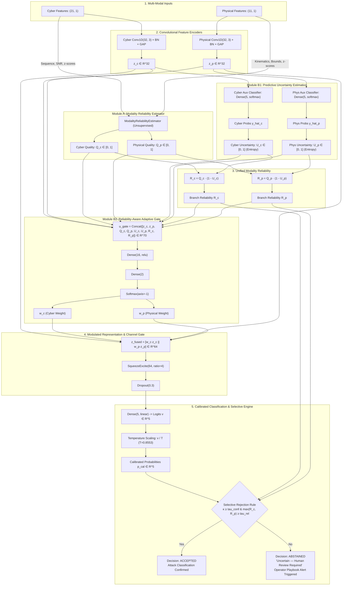

# 07. RA-SAFE: Complete Architecture & Research Specification

This document provides a comprehensive, rigorous technical breakdown of **RA-SAFE (Reliability-Aware Selective Fusion for UAV Cyber-Physical Intrusion Detection)**.

---

## 1. High-Level Architectural Graph

---

## 2. Module A: Modality Reliability Estimator ($Q_c, Q_p$)

### Purpose & Scientific Principle
The estimator evaluates physical and protocol data plausibility at inference time without requiring ground-truth labels. It produces continuous quality scores bounded in $[0.01, 0.99]$.

### Cyber Quality Score ($Q_c$)
Evaluates wireless channel health across 3 indicators:
1. **Statistical Mahalanobis / Z-Score Plausibility ($q_{\text{stat}}$)**:
   Measures deviation from clean training feature means:
   $$z_{c, i} = \left|\frac{x_{c, i} - \mu_{c, i}}{\sigma_{c, i}}\right|$$
   $$\bar{z}_c = \frac{1}{21}\sum_{i=1}^{21} \min(z_{c, i}, 10.0), \quad q_{\text{stat}} = \exp(-0.35 \cdot \bar{z}_c)$$
2. **Signal-to-Noise Ratio (SNR) Plausibility ($q_{\text{snr}}$)**:
   Evaluates feature 20 (`wlan_radio.SNR (db)`):
   $$q_{\text{snr}} = \frac{1}{1 + \exp(-1.5 (\text{SNR} - \text{median}(\text{SNR}_{\text{train}})))}$$
   Clipped to $[0.1, 1.0]$. Severe RF jamming driving SNR to negative dB levels forces $q_{\text{snr}} \to 0.1$.
3. **Data Completeness ($q_{\text{comp}}$)**:
   Detects zeroed-out feature collapse during packet drops:
   $$z_{\text{frac}} = \frac{1}{21}\sum_{i=1}^{21} \mathbb{I}(x_{c, i} == 0), \quad q_{\text{comp}} = \text{clip}(1.0 - 1.2 \cdot z_{\text{frac}}, 0.05, 1.0)$$

**Aggregate Cyber Quality**:
$$Q_c = \text{clip}(0.50 \cdot q_{\text{stat}} + 0.25 \cdot q_{\text{snr}} + 0.25 \cdot q_{\text{comp}}, 0.01, 0.99)$$

### Physical Quality Score ($Q_p$)
Evaluates flight sensor plausibility:
1. **Statistical Envelope Plausibility ($q_{\text{stat}}$)**:
   $$\bar{z}_p = \frac{1}{11}\sum_{j=1}^{11} \min\left(\left|\frac{x_{p, j} - \mu_{p, j}}{\sigma_{p, j}}\right|, 10.0\right), \quad q_{\text{stat}} = \exp(-0.35 \cdot \bar{z}_p)$$
2. **Kinematic Acceleration Plausibility ($q_{\text{acc}}$)**:
   Evaluates total body acceleration magnitude:
   $$\|\mathbf{a}\| = \sqrt{a_{gx}^2 + a_{gy}^2 + a_{gz}^2}, \quad q_{\text{acc}} = \exp\left(-0.25 \max(0.0, \|\mathbf{a}\| - 2.5)\right)$$
3. **Velocity Plausibility ($q_{\text{vel}}$)**:
   $$\|\mathbf{v}\| = \sqrt{v_{gx}^2 + v_{gy}^2 + v_{gz}^2}, \quad q_{\text{vel}} = \exp\left(-0.25 \max(0.0, \|\mathbf{v}\| - 2.5)\right)$$

**Aggregate Physical Quality**:
$$Q_p = \text{clip}(0.50 \cdot q_{\text{stat}} + 0.25 \cdot q_{\text{acc}} + 0.25 \cdot q_{\text{vel}}, 0.01, 0.99)$$

---

## 3. Module B: Uncertainty-Aware Adaptive Fusion

### A. Branch Predictive Uncertainty ($U_c, U_p$)
Each encoder branch branches into an auxiliary classifier trained with active categorical cross-entropy loss:
$$\hat{\mathbf{y}}_c = \text{Softmax}(\mathbf{W}_c^{(a)} \mathbf{z}_c + \mathbf{b}_c^{(a)}) \in \mathbb{R}^5$$
$$\hat{\mathbf{y}}_p = \text{Softmax}(\mathbf{W}_p^{(a)} \mathbf{z}_p + \mathbf{b}_p^{(a)}) \in \mathbb{R}^5$$

Normalized Shannon entropy measures the unpredictability of each branch's predictions:
$$U_c = -\frac{1}{\ln 5} \sum_{k=1}^5 \hat{y}_{c, k} \ln(\hat{y}_{c, k} + 10^{-10}) \in [0, 1]$$
$$U_p = -\frac{1}{\ln 5} \sum_{k=1}^5 \hat{y}_{p, k} \ln(\hat{y}_{p, k} + 10^{-10}) \in [0, 1]$$

### B. Unified Branch Reliability ($R_c, R_p$)
Combines external observational quality with internal model prediction certainty:
$$R_c = Q_c \cdot (1 - U_c) \in [0, 1]$$
$$R_p = Q_p \cdot (1 - U_p) \in [0, 1]$$

- If incoming Wi-Fi packets are jammed ($Q_c \to 0$) or the cyber classifier is guessing ($U_c \to 1$), branch reliability $R_c \to 0$.
- If physical IMU sensors freeze ($Q_p \to 0$) or telemetry is inconsistent ($U_p \to 1$), physical reliability $R_p \to 0$.

### C. The 70-Dimensional Adaptive Gating Network
The gate receives:
$$\mathbf{u}_{\text{gate}} = [\mathbf{z}_c \,\|\, \mathbf{z}_p \,\|\, Q_c \,\|\, Q_p \,\|\, U_c \,\|\, U_p \,\|\, R_c \,\|\, R_p] \in \mathbb{R}^{32 + 32 + 1 + 1 + 1 + 1 + 1 + 1 = 70}$$

The two-layer MLP calculates the fusion weights $[w_c, w_p]$:
$$\mathbf{h}_{\text{gate}} = \text{ReLU}\left(\mathbf{W}_{g1} \mathbf{u}_{\text{gate}} + \mathbf{b}_{g1}\right) \in \mathbb{R}^{16}$$
$$\mathbf{s} = \mathbf{W}_{g2} \mathbf{h}_{\text{gate}} + \mathbf{b}_{g2} \in \mathbb{R}^2$$
$$w_c = \frac{e^{s_1}}{e^{s_1} + e^{s_2}}, \quad w_p = \frac{e^{s_2}}{e^{s_1} + e^{s_2}}, \quad w_c + w_p = 1.0$$

The fused cyber-physical representation is modulated accordingly:
$$\mathbf{z}_{\text{fused}} = [w_c \mathbf{z}_c \,\|\, w_p \mathbf{z}_p] \in \mathbb{R}^{64}$$

---

## 4. Numerical Demonstration of Adaptive Fusion

### Case 1: Hostile RF Jamming (Cyber Degraded, Physical Normal)
- Inputs: $Q_c = 0.15$ (SNR collapsed, sequence gaps), $U_c = 0.85$ (Cyber branch confused).
- Physical: $Q_p = 0.90$ (Kinematics nominal), $U_p = 0.10$ (Physical branch confident).
- Reliabilities:
  $$R_c = 0.15 \times (1 - 0.85) = 0.0225 \quad (\text{Severely Low})$$
  $$R_p = 0.90 \times (1 - 0.10) = 0.8100 \quad (\text{High})$$
- Gate Response: The gating network shifts fusion weights to **$w_c = 0.05, w_p = 0.95$**.
- Outcome: Cyber noise is suppressed; flight control is maintained via physical inertial navigation.

### Case 2: Sensor Freeze / FDI Fault (Cyber Normal, Physical Corrupted)
- Inputs: $Q_c = 0.92, U_c = 0.12 \implies R_c = 0.810$.
- Physical: $Q_p = 0.20$ (Zero variance / stuck-at), $U_p = 0.75 \implies R_p = 0.050$.
- Gate Response: Gate shifts to **$w_c = 0.92, w_p = 0.08$**.
- Outcome: Corrupted sensor readings are suppressed; network telemetry drives detection.

### Case 3: Simultaneous Catastrophic Degradation (Dual Failure)
- Inputs: $R_c = 0.08, R_p = 0.06$.
- Maximum Reliability: $\max(R_c, R_p) = 0.08 < \tau_{\text{rel}} = 0.25$.
- Outcome: Rather than outputting a forced, dangerous guess, the **Selective Prediction Engine triggers ABSTENTION** with an immediate critical failsafe warning.

---

## 5. Module C: Selective Prediction & Temperature Calibration

### Post-Hoc Temperature Scaling
Softmax outputs tend to be overconfident because cross-entropy training pushes logit magnitudes higher than true calibration requires. RA-SAFE applies temperature scaling on validation logits $\mathbf{v}$:
$$p_{\text{cal}, k} = \frac{\exp(v_k / T)}{\sum_{j=1}^5 \exp(v_j / T)}$$

On our validation set, optimizing Negative Log-Likelihood yielded:
$$T^* = 0.8553$$
- Calibration Performance: Expected Calibration Error (ECE) dropped from **0.0298** down to **0.0202** (a 32.2% reduction in calibration error).
- Confidence: $\kappa = \max_k p_{\text{cal}, k}$.
- Calibrated Uncertainty: $U_{\text{final}} = -\frac{1}{\ln 5}\sum_{k=1}^5 p_{\text{cal}, k} \ln(p_{\text{cal}, k} + \epsilon)$.

### Selective Decision Engine
Two validation-tuned thresholds govern acceptance:
- Confidence Threshold: $\tau_{\text{conf}} = 0.65$
- Reliability Threshold: $\tau_{\text{rel}} = 0.25$

$$\text{Decision} = \begin{cases} 
\text{ACCEPTED} & \text{if } \kappa \ge 0.65 \text{ and } \max(R_c, R_p) \ge 0.25 \\
\text{ABSTAINED} & \text{otherwise}
\end{cases}$$

### Key Selective Metrics Defined
- **Coverage**: Proportion of total test samples accepted:
  $$\text{Coverage} = \frac{N_{\text{accepted}}}{N_{\text{total}}} = 43.89\%$$
- **Selective Risk**: Error rate computed **exclusively** on accepted samples:
  $$\text{Selective Risk} = \frac{N_{\text{errors on accepted}}}{N_{\text{accepted}}} = 5.71\%$$
- **Accepted Set Accuracy**:
  $$\text{Accepted Accuracy} = 1.0 - \text{Selective Risk} = 94.29\%$$

*(Compared to unfiltered accuracy of 78.38%, selective prediction boosts accuracy by nearly 15 percentage points).*

---

## 6. End-to-End Inference Trace: Two Concrete Examples

### Example 1: Accepted Detection (De-authentication DoS Attack)
- **Input**: CSV Row 13750 (`central_combined`).
- **Feature Extraction**: Cyber features exhibit sequence gaps and high management frame rates; physical features show nominal hover.
- **Reliability Calculation**: $Q_c = 0.88, Q_p = 0.94$.
- **Auxiliary Heads**: Cyber branch predicts DoS with low uncertainty ($U_c = 0.15$); physical branch shows moderate uncertainty ($U_p = 0.40$).
- **Branch Reliabilities**: $R_c = 0.88 \times 0.85 = 0.75$, $R_p = 0.94 \times 0.60 = 0.56$.
- **Fusion Gate**: $w_c = 0.72, w_p = 0.28$.
- **Logits & Calibration**: Raw logits $v = [-2.1, 4.8, -1.5, -3.2, -2.8]$. Scaled by $T=0.8553 \implies \mathbf{p}_{\text{cal}}[\text{DoS}] = 0.985$.
- **Decision Engine**: $\kappa = 0.985 \ge 0.65$ and $\max(0.75, 0.56) \ge 0.25 \implies$ **ACCEPTED**.
- **Output**:
  - Predicted Class: **De-authentication DoS**
  - Confidence: **98.5%**
  - Status: **ACCEPTED**
  - Operator Action: *"Automated detection confirmed (DOS). Switch to backup link or pre-programmed RTL failsafe."*

### Example 2: Abstained Sample (Severe Simultaneous Jamming & Noise)
- **Input**: CSV Row 13750 with simultaneous noise injection ($20\%$ packet loss + $\sigma=1.5$ IMU noise).
- **Reliability Calculation**: $Q_c = 0.18, Q_p = 0.22$.
- **Auxiliary Heads**: High branch entropy $U_c = 0.82, U_p = 0.78$.
- **Branch Reliabilities**: $R_c = 0.18 \times 0.18 = 0.032$, $R_p = 0.22 \times 0.22 = 0.048$.
- **Fusion Gate**: $w_c = 0.48, w_p = 0.52$.
- **Logits & Calibration**: $\mathbf{p}_{\text{cal}} = [0.28, 0.31, 0.19, 0.12, 0.10] \implies \kappa = 0.31$.
- **Decision Engine**: $\kappa = 0.31 < 0.65$ and $\max(0.032, 0.048) = 0.048 < 0.25 \implies$ **ABSTAINED**.
- **Output**:
  - Predicted Class: **Uncertain — Human Review Required**
  - Confidence: **31.0%**
  - Status: **ABSTAINED**
  - Operator Playbook: *"CRITICAL: Dual-domain failure. Cyber link and physical sensor health both severely compromised. Immediately engage hardware Return-to-Home (RTH) failsafe or safe parachute descent."*
