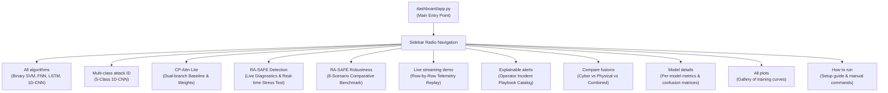
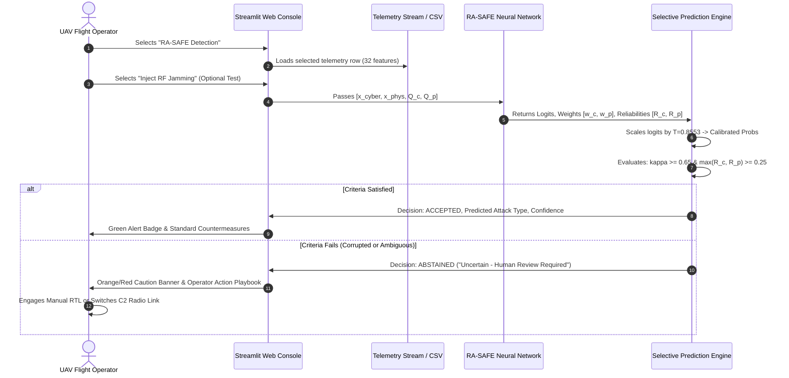

# 10. Streamlit Interactive Dashboard Architecture & Operator User Journey

This document explains the software architecture, data flows, UI components, and operator workflows for the Streamlit dashboard.

---

## 1. Application Entry Point & Navigation Architecture

The web dashboard is launched via:
```powershell
python -m streamlit run dashboard/app.py
```

### Architecture Diagram


---

## 2. Page-by-Page Technical Breakdown

### 1. `All algorithms` (`show_all_algorithms`)
- **Purpose**: High-level comparison across the four binary models (SVM, FNN, LSTM, 1D-CNN).
- **Data Source**: Ingests `results/metrics.json` via `load_all_metrics()`.
- **UI Elements**: F1-score summary cards, interactive metric table, comparative bar chart across fusions (`drone1_cyber`, `drone1_physical`, `drone1_combined`), and accuracy heatmaps.

### 2. `Multi-class attack ID` (`show_multiclass_attack_id`)
- **Purpose**: Evaluates the 5-class 1D-CNN baseline on `central_combined`.
- **Data Source**: `results/metrics_multiclass.json`.
- **UI Elements**: Accuracy/F1 metric cards, per-class precision/recall breakdown, and rendered confusion matrix plot (`multiclass_results/confusion_central_combined.png`).

### 3. `CP-Attn-Lite` (`dashboard/cp_attn_view.py`)
- **Purpose**: Visualizes the baseline dual-branch attention architecture.
- **UI Elements**: Model parameter count (3,095), inference latency (0.08 ms), confusion matrix, and average cyber vs physical attention weights grouped by true attack class.

### 4. `RA-SAFE Detection` (`dashboard/ra_safe_view.py`) — **Core New Page**
- **Purpose**: Live diagnostic console and interactive stress-test sandbox for RA-SAFE.
- **Data Flow**:
  1. Loads `models/checkpoints/ra_safe_model.keras`, `reliability_estimator.json`, and `selective_classifier.json`.
  2. The user inputs a row index (0 to 54,782).
  3. The user optionally selects an interactive degradation mode (Packet Loss, RF Jamming, IMU Noise, Sensor Freeze).
  4. The model computes $Q_c, Q_p$, executes a forward pass, scales logits by $T=0.8553$, and evaluates selective acceptance criteria.
- **UI Elements**:
  - Model Performance Overview Cards (Accuracy, Parameters, Latency, Calibration Error).
  - Decision Status Badge: Green **ACCEPTED** or Orange **ABSTAINED**.
  - Metrics: Predicted Class, Calibrated Confidence, Cyber Reliability ($R_c$), Physical Reliability ($R_p$), Adaptive Fusion Weights ($w_c, w_p$).
  - **Operator Action Playbook Banner**: Specific actionable emergency response instructions.
  - Calibrated probability distribution bar chart across all 5 classes.
  - Diagnostic Tabs: Test confusion matrix, training curves, and class-wise fusion weights.

### 5. `RA-SAFE Robustness` (`dashboard/robustness_view.py`) — **New Page**
- **Purpose**: Presents the comparative degradation stress-test benchmarks.
- **Data Source**: `results/robustness_metrics.json` and `results/robustness_comparison.png`.
- **UI Elements**: Comparative table highlighting CP-Attn-Lite vs RA-SAFE accuracy, coverage, accepted set accuracy, and adaptive weight shifts across all 8 degradation modes.

### 6. `Live streaming demo` (`dashboard/live_streaming.py`)
- **Purpose**: Replays pre-recorded CSV rows sequentially (e.g. rows 13,700 to 13,900 crossing from Benign into DoS) to simulate a real-time ground control telemetry stream and measure per-sample inference latency.
- **Controls**: Start Stream, Pause, Step +1, Reset, Delay slider (0–500 ms).
- **UI Elements**: Rolling accuracy meter, live alert cards, probability distribution, and scrolling 50-row telemetry log.

### 7. `Explainable alerts` (`dashboard/explainable_alerts.py`)
- **Purpose**: Operator technical encyclopedia explaining the technical indicators and recommended countermeasures for each attack class.
- **Data Source**: `scripts/attack_info.py`.

---

## 3. End-to-End Operator User Journey



---

## 4. Troubleshooting Common Dashboard Issues

### Issue 1: "No module named 'dashboard'" or Path Resolution Errors
- **Cause**: Launching Streamlit from inside the `dashboard/` subfolder.
- **Solution**: Always launch from the repository root:
  ```powershell
  cd "C:\Users\HP\OneDrive\Documents\Cyber-Physical-Intrusion-Detection-System-for-Unmanned-Aerial-Vehicles"
  C:\uav-venv\Scripts\python.exe -m streamlit run dashboard/app.py
  ```

### Issue 2: "RA-SAFE model not found" Warning
- **Cause**: Model checkpoints have not been generated yet.
- **Solution**: Run training once to generate weights and parameters:
  ```powershell
  C:\uav-venv\Scripts\python.exe training/train_ra_safe.py --epochs 12
  ```

### Issue 3: Port 8501 Already in Use
- **Cause**: Another Streamlit instance is running in the background.
- **Solution**: Specify an alternative port:
  ```powershell
  C:\uav-venv\Scripts\python.exe -m streamlit run dashboard/app.py --server.port 8502
  ```
