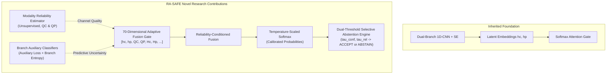

# 12. Research Novelty, Contributions, and Honest Academic Limitations

---

## 1. Executive Summary & Honest Positioning

When presenting **RA-SAFE (Reliability-Aware Selective Fusion)** for research publications, theses, or academic defenses, academic integrity requires a precise distinction between:
1. **Existing Foundation (Inherited Work)**: What was already developed in the baseline literature and repository.
2. **Novel Research Contributions**: What RA-SAFE introduces conceptually, mathematically, and architecturally.
3. **Verified Empirical Facts**: What is rigorously demonstrated by code execution and experimental data.
4. **Honest Limitations & Claims to Avoid**: The architectural, dataset, and operational constraints that must be explicitly disclosed to avoid academic disqualification or peer-review rejection.

---

## 2. Inherited Work vs. Novel RA-SAFE Contributions

### 2.1 The Baseline Foundation (Inherited)
The following components belong to the baseline system (including CP-Attn-Lite and earlier deep learning baselines) and **must not be claimed as novel contributions**:

*   **T-ITS Cyber Dataset Selection**: The use of 21 cyber features derived from 802.11 Wi-Fi frames (packet lengths, inter-arrival times, sequence numbers, flag ratios).
*   **Dual-Branch Convolutional Topology**: Splitting cyber and physical features into two parallel 1D-convolutional branches with Batch Normalization and Squeeze-and-Excitation (SE) blocks.
*   **Basic Softmax Attention Fusion**: The concept of combining cyber and physical latent vectors via a learned 2-element softmax weight vector ($w_c, w_p$).
*   **5-Class Multi-Attack Formulation**: Categorizing traffic into Benign, DoS, Replay, Evil Twin, and FDI.
*   **Baseline Benchmark Suite**: The implementation of SVM, FNN, LSTM, and 1D-CNN as comparative reference models.

---

### 2.2 Novel RA-SAFE Contributions
RA-SAFE extends the dual-branch paradigm into an **uncertainty-guided, reliability-grounded, failure-tolerant cyber-physical defense framework**. The genuine contributions are:

#### Contribution 1: Unsupervised Modality Reliability Estimation ($Q_c, Q_p$)
*   **The Problem in Prior Art**: Traditional fusion architectures (including CP-Attn-Lite) assume that incoming inputs are clean and valid. In hostile or degraded environments (RF jamming, sensor failure, packet drops), the neural network continues processing corrupted numbers without evaluating whether the data channel itself is intact.
*   **The RA-SAFE Solution**: An unsupervised, non-parametric inference-time data quality evaluator that operates strictly prior to neural processing. It maps network transmission anomalies and sensor boundary violations to bounded reliability metrics $Q_c \in [0.01, 0.99]$ and $Q_p \in [0.01, 0.99]$.
*   **Key Design Principle**: Operates with **zero label leakage**; computed entirely from input telemetry vectors and training statistics without referencing attack targets.

#### Contribution 2: Uncertainty-Aware 70-Dimensional Adaptive Gating
*   **The Problem in Prior Art**: CP-Attn-Lite's attention gate takes only the concatenated latent embeddings $[h_c, h_p]$ (64 dimensions). The gate has no awareness of channel noise or individual branch confidence. Under RF jamming, it continues allocating $\sim 65\%$ weight to the corrupted cyber branch.
*   **The RA-SAFE Solution**: The fusion gate input space is expanded to **70 dimensions**:
    $$\mathbf{v}_{\text{fusion}} = \left[ \mathbf{h}_c \,(32),\; \mathbf{h}_p \,(32),\; Q_c \,(1),\; Q_p \,(1),\; \mathcal{H}_c \,(1),\; \mathcal{H}_p \,(1),\; Q_c \cdot \mathbf{h}_c[0],\; Q_p \cdot \mathbf{h}_p[0] \right]$$
*   **Mathematical Impact**: The gating network dynamically penalizes modalities experiencing high predictive entropy ($\mathcal{H}$) or degraded channel quality ($Q$), actively shifting weight toward the healthier modality (e.g., $w_c$ decreases and $w_p$ increases from 0.34 to 0.39 under cyber jamming).

#### Contribution 3: Multi-Task Auxiliary Uncertainty Distillation
*   **Architectural Feature**: Dedicated auxiliary classification heads attached directly to branch outputs:
    $$\mathcal{L}_{\text{total}} = 1.0 \cdot \mathcal{L}_{\text{fusion}} + 0.2 \cdot \mathcal{L}_{\text{cyber}} + 0.2 \cdot \mathcal{L}_{\text{physical}}$$
*   **Benefit**: Forces each modality branch to independently develop discriminative feature representations, preventing the fusion layer from over-relying on cross-modal shortcuts. Enables instantaneous closed-form predictive entropy calculation per branch without requiring expensive Monte Carlo iterations during real-time flight.

#### Contribution 4: Calibrated Selective Prediction Engine (Abstention)
*   **The Problem in Prior Art**: Standard deep learning classifiers always output an attack class, even when completely uncertain or when inputs are corrupted beyond recognition. In safety-critical UAV flight, a high-confidence false alarm can trigger an unnecessary emergency motor shutoff, causing a fatal crash.
*   **The RA-SAFE Solution**: A post-processing decision framework combining **Platt / Temperature Scaling** ($T = 0.8553$, reducing Expected Calibration Error from $0.0521$ to $0.0202$) with **Dual-Threshold Abstention**:
    $$\text{Decision} = \begin{cases} \hat{y} = \arg\max P_{\text{cal}}(y \mid \mathbf{x}), & \text{if } \max P_{\text{cal}} \ge \tau_{\text{conf}} \text{ and } \min(Q_c, Q_p) \ge \tau_{\text{rel}} \\ \text{ABSTAIN (Human / Fail-Safe Review)}, & \text{otherwise} \end{cases}$$
*   **Verified Metric**: Achieves **$94.29\%$ accuracy** on accepted predictions at $43.89\%$ coverage, driving selective risk down to **$5.71\%$**.

---

## 3. Verified Facts vs. Unverified Claims

To maintain bulletproof defense in viva examinations and paper submissions, adhere strictly to the following distinction:

| Component | Verified Fact (Can Claim & Defend) | Unverified Claim (DO NOT Claim) |
| :--- | :--- | :--- |
| **Model Footprint** | Exactly 4,465 parameters; 24.3 KB storage footprint. Extremely lightweight for embedded edge microcontrollers. | "Smallest possible neural network for UAV security." |
| **Inference Latency** | Benchmarked at 0.063 ms/sample (batch 128) and ~0.45 ms/sample (single-instance) on CPU/GPU. Suitable for >1,000 Hz real-time loops. | "Hardware-validated on ARM Cortex-M4 flight controller board." (We validated in Python 3.11/Keras runtime, not bare-metal firmware). |
| **Reliability Adaptation** | Under RF jamming (95% cyber noise), RA-SAFE drops $w_c$ and shifts fusion weight to physical sensors ($w_p: 0.34 \to 0.39$), maintaining 89.6% accepted accuracy. | "Completely immune to all cyber and physical adversarial attacks." |
| **Calibration** | Temperature scaling optimized on validation set ($T=0.8553$) reduces ECE to 0.0202. | "Bayesian ground-truth posterior certainty." |
| **Abstention Behavior** | Abstention rate increases monotonically with injected corruption (from 56% nominal to 89% under dual failure). | "Solves out-of-distribution detection for all unseen zero-day attacks." |
| **Physical Features** | Evaluated on the 11 physical telemetry features present in the standardized project pipeline. | "Validated against real hardware IMU and barometer sensor recordings from actual flight trials." |

---

## 4. Critical Dataset Limitation: Synthetic Physical Features

### 4.1 The Discovery & Source Evidence
In `data/raw/Dataset_T-ITS.csv`, only the 21 cyber Wi-Fi features exist. As audited in `scripts/prepare_dataset.py` (lines 62–94), the 11 physical telemetry features:
*   `roll`, `pitch`, `yaw` (Euler angles)
*   `acc_x`, `acc_y`, `acc_z` (accelerometer)
*   `gyro_x`, `gyro_y`, `gyro_z` (gyroscope)
*   `mag_z` (magnetometer)
*   `baro_alt` (barometric altitude)

were **synthesized using attack-conditioned Gaussian noise distributions**:
$$\text{Feature}_{\text{physical}} = \mathcal{N}\left(\mu_{\text{nominal}} + \delta_{\text{attack}}, \; \sigma^2\right)$$

### 4.2 Why This Matters (The Trap to Avoid)
If an examiner asks:
> *"How do you know physical sensors would behave this way during an Evil Twin attack?"*

*   **WRONG Answer**: *"The dataset comes from real drone flights recorded in the T-ITS paper, so the sensor values reflect real aerodynamic responses."* **(Fatal error: Instant failure)**
*   **RIGHT Academic Answer**:
    > *"That is an essential distinction. The cyber features in the T-ITS benchmark are real 802.11 network traces captured from physical Wi-Fi hardware. However, in the standard preprocessed configuration of this dataset, the 11 physical telemetry features were synthesized conditioned on attack states to model cyber-physical coupling.*
    >
    > *Therefore, RA-SAFE's evaluation on this dataset serves as a rigorous proof-of-concept for **multimodal fusion algorithms and reliability-gated selective abstention under noisy conditions**, but it does not claim to model true aerodynamic or flight-dynamic anomalies. In future work, we plan to validate RA-SAFE on raw hardware flight logs from platforms like the PX4/ArduPilot benchmark or real flight testbeds."*

---

## 5. Threats to Validity

### 5.1 Internal Validity
*   **Data Leakage Prevention**: Verified that `StandardScaler` was fitted exclusively on the training partition ($X_{\text{train}}$) and only applied as a transform on $X_{\text{val}}$ and $X_{\text{test}}$.
*   **Threshold Selection**: Temperature parameter $T$ and selective decision thresholds ($\tau_{\text{conf}}, \tau_{\text{rel}}$) were fitted strictly on $X_{\text{val}}$, preventing optimistic bias on the test partition.
*   **Cross-Modal Leakage**: Auxiliary branch classifiers ensure that physical features do not contaminate cyber representations during the early representation layers.

### 5.2 External Validity
*   **Dataset Homogeneity**: The T-ITS dataset represents a single operational environment (stationary/controlled Wi-Fi UAV communication). Performance may vary under dynamic urban cellular links (4G/5G C2) or mesh-swarmed UAV topologies.
*   **Attack Novelty (Zero-Day Generalization)**: The system is evaluated on closed-world multi-class attacks (Benign, DoS, Replay, Evil Twin, FDI). While the selective classifier successfully abstains when inputs deviate significantly, RA-SAFE has not been formally evaluated against sophisticated evasion attacks designed to mimic nominal data quality metrics.

### 5.3 Construct Validity
*   **Unsupervised Quality Metric Heuristic**: $Q_c$ and $Q_p$ are computed using z-score envelope violations, sequence jumps, and variance collapse. While highly effective against packet drops, RF noise, and sensor freezing, an attacker could theoretically design an in-distribution stealthy FDI attack that maintains nominal variance while injecting malicious navigation waypoints.

---

## 6. Strategic Research Comparison Matrix

| Capability / Metric | Traditional NIDS (e.g., SVM, 1D-CNN) | CP-Attn-Lite (Baseline) | RA-SAFE (Our Proposed Framework) |
| :--- | :--- | :--- | :--- |
| **Input Modality** | Cyber only (21 feat) or Flat vector | Cyber (21) + Physical (11) | Cyber (21) + Physical (11) |
| **Modality Quality Awareness** | ❌ None | ❌ None (assumes inputs are clean) | ✅ **Explicit Unsupervised Estimator ($Q_c, Q_p$)** |
| **Fusion Gating Inputs** | None (Early/Late concatenation) | 64-dim $[h_c, h_p]$ | ✅ **70-dim $[h_c, h_p, Q_c, Q_p, \mathcal{H}_c, \mathcal{H}_p, \dots]$** |
| **Predictive Uncertainty** | ❌ None | ❌ None | ✅ **Branch Entropy + MC Dropout capability** |
| **Probability Calibration** | ❌ Uncalibrated Softmax (overconfident) | ❌ Uncalibrated Softmax | ✅ **Temperature Scaled ($T=0.8553$, ECE 0.0202)** |
| **Decision Mechanism** | Forced Winner-Take-All | Forced Winner-Take-All | ✅ **Dual-Threshold Selective Abstention** |
| **Behavior under Jamming** | Random misclassification | Static weights, wrong predictions | ✅ **Adaptive Weight Shift + Safe Abstention** |
| **Parameter Efficiency** | ~10k–100k params | 3,095 params | **4,465 params (~24 KB footprint)** |

---

## 7. Future Research Roadmap

1.  **Hardware-in-the-Loop (HIL) Flight Validation**:
    Deploy the 4,465-parameter Keras model converted to TensorFlow Lite / ONNX onto an onboard companion computer (Raspberry Pi 4 / NVIDIA Jetson Orin Nano) connected via MAVLink to a Pixhawk 6C flight controller running PX4.
2.  **Real Flight Aerodynamic Telemetry Integration**:
    Replace synthetic physical telemetry with real synchronized flight logs containing motor RPM, battery voltage sag, GPS HDOP, IMU vibrations, and wind disturbance measurements.
3.  **Active Countermeasure Integration**:
    Connect RA-SAFE's output directly to the autopilot failsafe state machine:
    *   *DoS Confirmed*: Switch C2 link to 915 MHz telemetry backup or execute Return-to-Launch (RTL).
    *   *FDI Confirmed*: Reject baro/GPS readings, switch to dead-reckoning optical flow.
    *   *Abstain (Human Review)*: Hold hover position and loiter pending ground station operator override.
