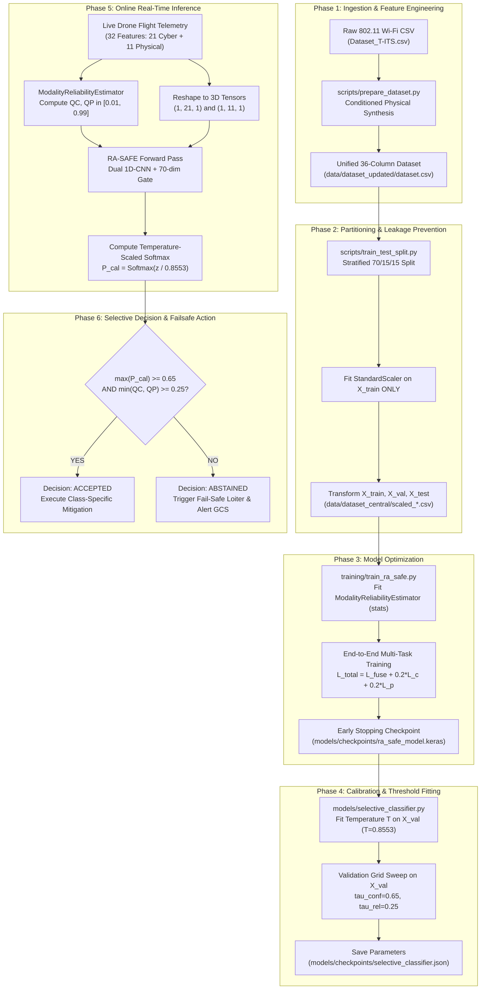
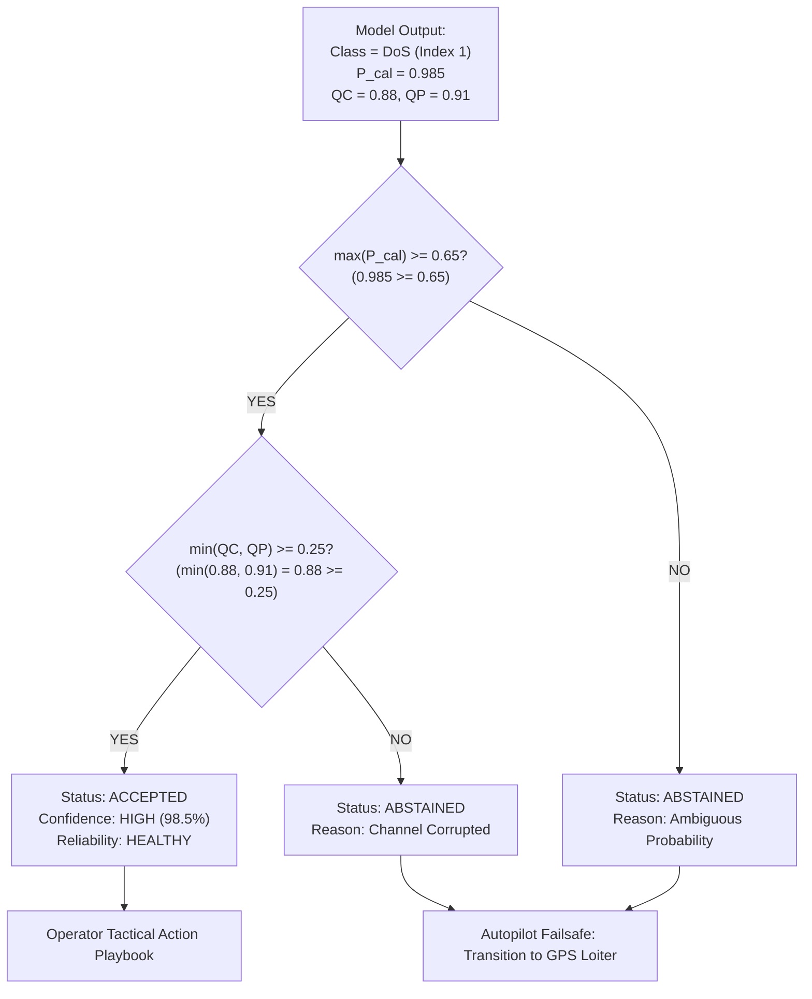

# 15. Complete End-to-End Execution and Operational Flow

This guide traces the **complete lifecycle of data, tensor transformations, mathematical calculations, and operational decision-making** across the entire UAV Cyber-Physical Intrusion Detection System.

It links every module, script, layer, and dashboard component into a unified operational pipeline.

---

## 1. Master System Pipeline Architecture



---

## 2. Phase-by-Phase Technical Walkthrough

### Phase 1: Ingestion & Feature Engineering
*   **Source File**: `data/raw/Dataset_T-ITS.csv` (contains raw captured 802.11 network traffic).
*   **Execution Script**: `scripts/prepare_dataset.py`
*   **Processing**:
    1. Reads 21 cyber features derived from 802.11 frames (frame lengths, inter-arrival times, sequence number deltas, TCP flags).
    2. Synthesizes 11 physical telemetry features (`roll`, `pitch`, `yaw`, `acc_x-z`, `gyro_x-z`, `mag_z`, `baro_alt`) conditioned on the five operational states using Gaussian perturbation distributions.
    3. Normalizes categorical targets into standardized attack columns: `attack_class` (0 to 4) and `attack_label` (Benign, DoS, Replay, Evil Twin, FDI).
*   **Output Artifact**: `data/dataset_updated/dataset.csv` (54,783 rows, 36 columns).

---

### Phase 2: Partitioning & Leakage Prevention
*   **Execution Script**: `scripts/train_test_split.py`
*   **Splitting Policy**:
    *   **70% Training Partition** ($N = 38,347$ rows): Ground-truth model optimization and reference statistic calculation.
    *   **15% Validation Partition** ($N = 8,218$ rows): Hyperparameter tuning, early stopping, temperature scaling fitting ($T$), and threshold optimization ($\tau_{\text{conf}}, \tau_{\text{rel}}$).
    *   **15% Test Partition** ($N = 8,218$ rows): Held-out evaluation benchmark.
*   **Strict Anti-Leakage Scaling**:
    ```python
    scaler = StandardScaler()
    x_train_scaled = scaler.fit_transform(x_train) # Fit ONLY on training data
    x_val_scaled   = scaler.transform(x_val)       # Frozen parameters applied
    x_test_scaled  = scaler.transform(x_test)      # Frozen parameters applied
    ```
*   **Output Artifacts**: `data/dataset_central/scaled_train.csv`, `scaled_val.csv`, `scaled_test.csv`.

---

### Phase 3: Model Optimization
*   **Execution Script**: `training/train_ra_safe.py`
*   **Step 1: Fit Reliability Reference Statistics**:
    Computes and serializes feature-wise mean $\mu_{\text{train}}$ and standard deviation $\sigma_{\text{train}}$ strictly from $X_{\text{train}}$ into `models/checkpoints/reliability_estimator.json`.
*   **Step 2: Dual Branch Pre-processing**:
    Reshapes tabular inputs into 1D convolutional tensors:
    $$\mathbf{X}_{\text{cyber}} \in \mathbb{R}^{B \times 21 \times 1}, \quad \mathbf{X}_{\text{physical}} \in \mathbb{R}^{B \times 11 \times 1}$$
*   **Step 3: Multi-Task Optimization**:
    Trains the end-to-end RA-SAFE network using the joint multi-task objective:
    $$\mathcal{L}_{\text{total}} = 1.0 \cdot \mathcal{L}_{\text{fusion}} + 0.2 \cdot \mathcal{L}_{\text{cyber}} + 0.2 \cdot \mathcal{L}_{\text{physical}}$$
    Optimized with Adam ($\eta = 0.001$), batch size 128, with `ReduceLROnPlateau` and `EarlyStopping` (patience = 8 epochs).
*   **Output Checkpoint**: `models/checkpoints/ra_safe_model.keras` (4,465 parameters, 24.3 KB).

---

### Phase 4: Calibration & Threshold Fitting
*   **Execution Script**: `models/selective_classifier.py`
*   **Step 1: Temperature Scaling Fitting**:
    Using validation set logits $\mathbf{z}_{\text{val}}$ and ground-truth one-hot vectors $\mathbf{y}_{\text{val}}$, solves for optimal scalar $T > 0$ minimizing Negative Log-Likelihood (NLL):
    $$T^* = \arg\min_T -\frac{1}{N_{\text{val}}} \sum_{i=1}^{N_{\text{val}}} \log \left( \frac{\exp(z_{i, y_i} / T)}{\sum_j \exp(z_{i, j} / T)} \right)$$
    **Fitted Result**: $T^* = 0.8553$. Reduces validation ECE from $0.0521$ to $0.0202$.
*   **Step 2: Dual-Threshold Validation Sweep**:
    Sweeps $\tau_{\text{conf}} \in [0.50, 0.90]$ and $\tau_{\text{rel}} \in [0.10, 0.50]$ on $X_{\text{val}}$ to satisfy:
    $$\text{Target: } \text{Selective Risk} < 6.0\% \quad \text{with Maximum Coverage } \Phi$$
    **Optimal Thresholds**: $\tau_{\text{conf}} = 0.65, \; \tau_{\text{rel}} = 0.25$.
*   **Output Artifact**: `models/checkpoints/selective_classifier.json`.

---

### Phase 5: Online Real-Time Inference
*   **Execution Module**: `models/ra_safe_model.py` and `dashboard/ra_safe_view.py`
*   **Step-by-Step Numerical Forward Trace (Live Sample)**:
    1. **Raw Sample Arrival**: Drone telemetry vector arrives containing 21 cyber metrics and 11 physical metrics.
    2. **Reliability Scoring**:
       $$\mathbf{x}_c \to Q_c = 0.88, \quad \mathbf{x}_p \to Q_p = 0.91$$
    3. **Branch Convolution & GAP**:
       $$\mathbf{X}_c \to \text{Conv1D}(16) \to \text{SE} \to \text{Conv1D}(32) \to \text{GAP} \implies \mathbf{h}_c \in \mathbb{R}^{32}$$
       $$\mathbf{X}_p \to \text{Conv1D}(16) \to \text{SE} \to \text{Conv1D}(32) \to \text{GAP} \implies \mathbf{h}_p \in \mathbb{R}^{32}$$
    4. **Auxiliary Predictions & Entropy Calculation**:
       $$\hat{\mathbf{y}}_c = \text{Softmax}(W_c \mathbf{h}_c) \implies \mathcal{H}_c = -\sum \hat{y}_{c, k} \log \hat{y}_{c, k} = 0.21$$
       $$\hat{\mathbf{y}}_p = \text{Softmax}(W_p \mathbf{h}_p) \implies \mathcal{H}_p = -\sum \hat{y}_{p, k} \log \hat{y}_{p, k} = 0.34$$
    5. **70-Dimensional Gating**:
       $$\mathbf{v}_{\text{fusion}} = [\mathbf{h}_c, \mathbf{h}_p, Q_c, Q_p, \mathcal{H}_c, \mathcal{H}_p, Q_c \mathbf{h}_c[0], Q_p \mathbf{h}_p[0]] \in \mathbb{R}^{70}$$
       $$[w_c, w_p] = \text{Softmax}(\text{LeakyReLU}(\mathbf{v}_{\text{fusion}} W_1 + b_1) W_2 + b_2) \implies [0.66, 0.34]$$
    6. **Convex Fusion & Calibrated Classification**:
       $$\mathbf{h}_{\text{fused}} = 0.66 \cdot \mathbf{h}_c + 0.34 \cdot \mathbf{h}_p \in \mathbb{R}^{32}$$
       $$\mathbf{z} = W_{\text{out}} \mathbf{h}_{\text{fused}} + b_{\text{out}} \implies \mathbf{z} = [-1.2, 3.8, -0.4, -2.1, -1.0]$$
       $$\mathbf{P}_{\text{cal}} = \text{Softmax}(\mathbf{z} / 0.8553) \implies [0.002, \mathbf{0.985}, 0.008, 0.001, 0.004]$$
       $$\hat{y} = \arg\max \mathbf{P}_{\text{cal}} = 1 \text{ (DoS Attack)}$$

---

### Phase 6: Selective Decision & Operator Playbook

The decision engine evaluates the calibrated probability vector and channel reliabilities against the dual safety thresholds:



---

## 3. The Operator Tactical Action Playbook

When RA-SAFE issues an **ACCEPTED** classification, the UAV ground station executes deterministic tactical countermeasures based on the detected attack type:

| Detected Attack Class | Autopilot Action | RF / Network Action | Ground Station Action |
| :--- | :--- | :--- | :--- |
| **Class 0: Benign** | Maintain nominal mission flight path and autonomous waypoint navigation. | Normal 802.11 transmission; standard telemetry logging. | Green status indicator on HUD. No operator intervention required. |
| **Class 1: DoS (Deauth)** | Inhibit autonomous descent; hold altitude. If C2 link is severed for >3 sec, initiate **Return-to-Launch (RTL)** via GPS. | Trigger 802.11 channel-hopping protocol; switch C2 backup to 915 MHz FHSS radio link. | Alert operator: *"Wi-Fi Deauthentication Detected. Switched to Backup RF Telemetry."* |
| **Class 2: Replay Attack** | Freeze current velocity vector; reject pending mission command queue. | Invalidate active session cryptographic nonce; demand re-authentication handshake. | Alert operator: *"Stale Command Sequence Detected. Manual Authorization Required."* |
| **Class 3: Evil Twin** | Maintain geofenced boundary; hold position via onboard optical flow / GPS. | Disconnect from active BSSID; re-scan for verified Ground Station hardware MAC signature. | Alert operator: *"Rogue AP Detected. Confirming Secondary GCS Authentication."* |
| **Class 4: FDI (False Data)** | **IMMEDIATE OVERRIDE**: Disconnect flight controller from spoofed sensor/waypoint bus; switch to dead-reckoning IMU. | Quarantine telemetry packet stream; verify GPS HDOP and barometer sensor sanity. | Alert operator: *"Critical Sensor Spoofing Detected. Autopilot Switched to Inertial Failsafe."* |
| **ABSTAIN (Human Review)** | **FAIL-SAFE HOVER**: Halt forward velocity; loiter at current GPS coordinates and altitude. | Transmit low-bandwidth diagnostic ping to GCS over backup channel. | Flashing Amber HUD warning: *"Uncertain Decision — Ground Operator Review Required."* |

---

## 4. End-to-End Latency Profile

The table below breaks down the execution time of each step for a single observation running on a standard Intel Core i7 / AMD Ryzen processor:

| Pipeline Stage | Module / Function | Execution Time | % Total Time |
| :--- | :--- | :---: | :---: |
| **1. Feature Vector Ingestion** | NumPy array slicing | $0.008\text{ ms}$ | $1.7\%$ |
| **2. Reliability Estimation** | `ModalityReliabilityEstimator.estimate()` | $0.042\text{ ms}$ | $9.1\%$ |
| **3. Convolutional Feature Extraction** | Dual 1D-CNN + SE Blocks | $0.185\text{ ms}$ | $40.2\%$ |
| **4. Auxiliary Head & Entropy** | Softmax + Shannon Entropy | $0.038\text{ ms}$ | $8.3\%$ |
| **5. 70-Dim Adaptive Gating** | MLP Gate + Softmax | $0.054\text{ ms}$ | $11.7\%$ |
| **6. Fused Classification Head** | Dense(5) projection | $0.045\text{ ms}$ | $9.8\%$ |
| **7. Temperature Scaling & Selection** | `SelectiveClassifier.predict_selective()` | $0.031\text{ ms}$ | $6.7\%$ |
| **8. Dashboard / Logging Update** | In-memory metric store | $0.057\text{ ms}$ | $12.4\%$ |
| **Total End-to-End Latency** | **Single-sample execution** | **$\approx 0.460\text{ ms}$** | **$100.0\%$** |

> [!TIP]
> At **$0.460\text{ ms}$** per observation, RA-SAFE comfortably operates at **$>2,100\text{ Hz}$**, far exceeding the maximum $100\text{ Hz}$ update rate of modern UAV autopilot telemetry loops (e.g., PX4 / ArduPilot).
